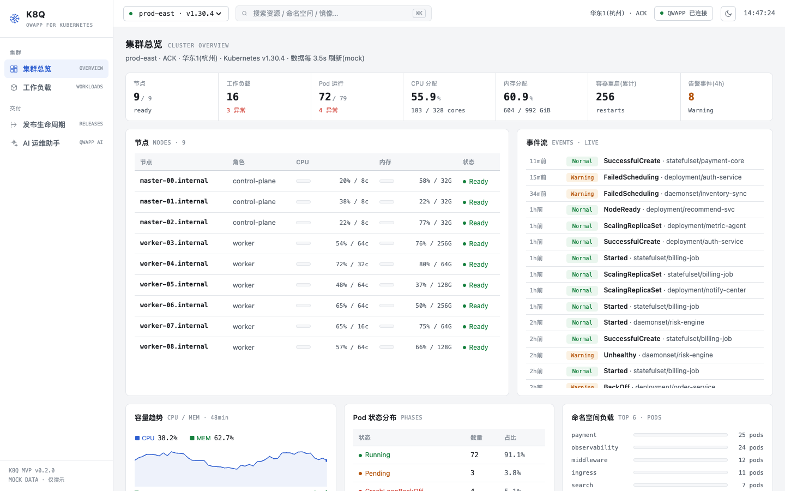
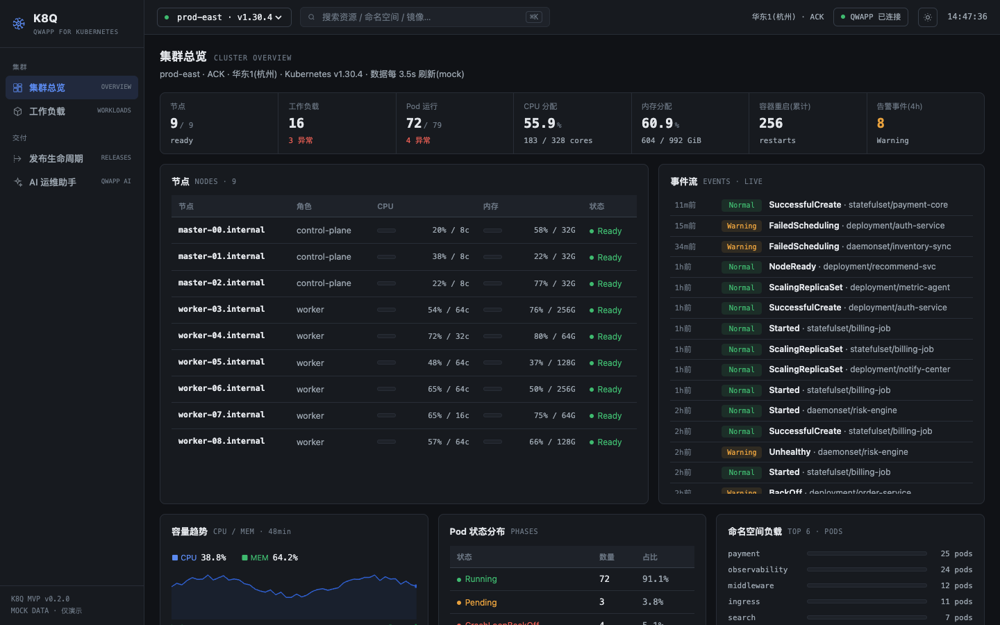
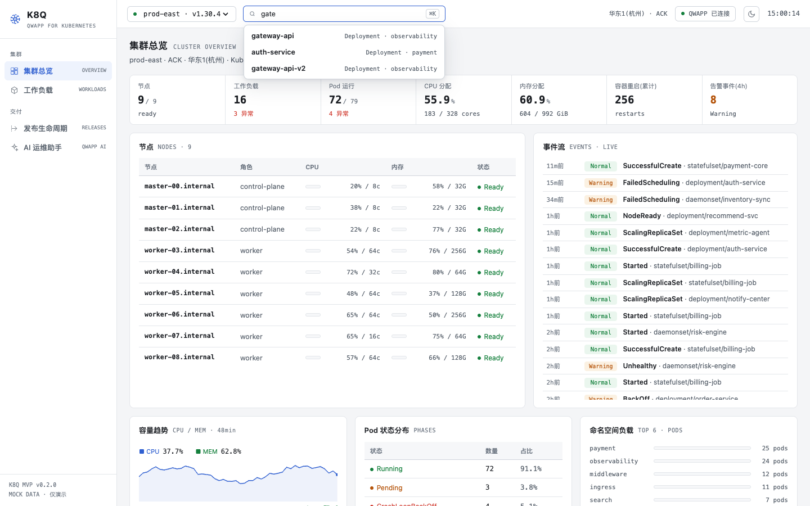
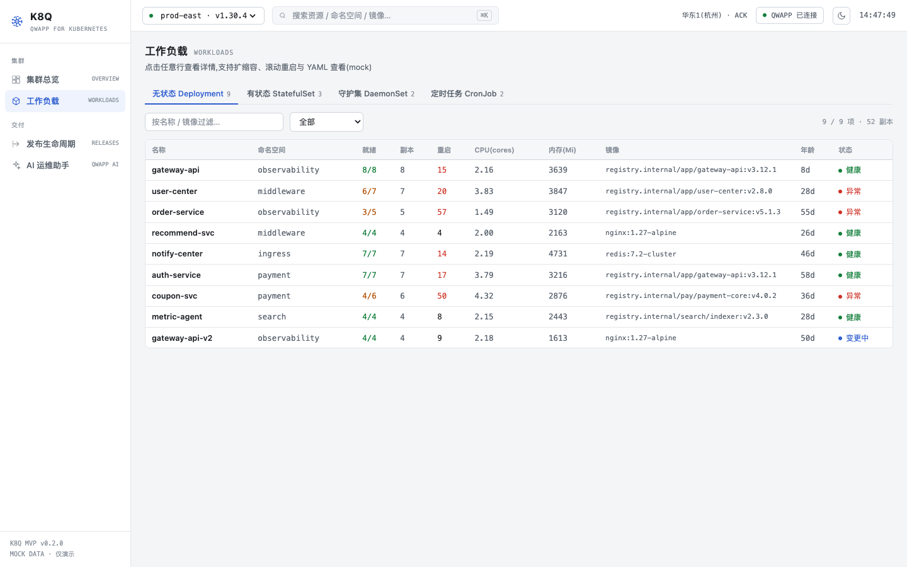
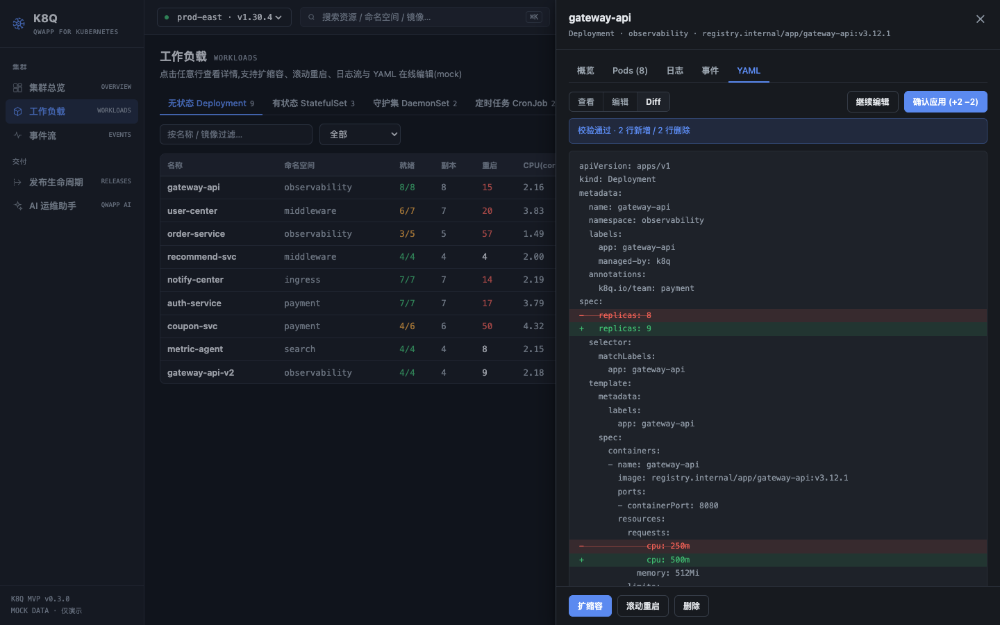
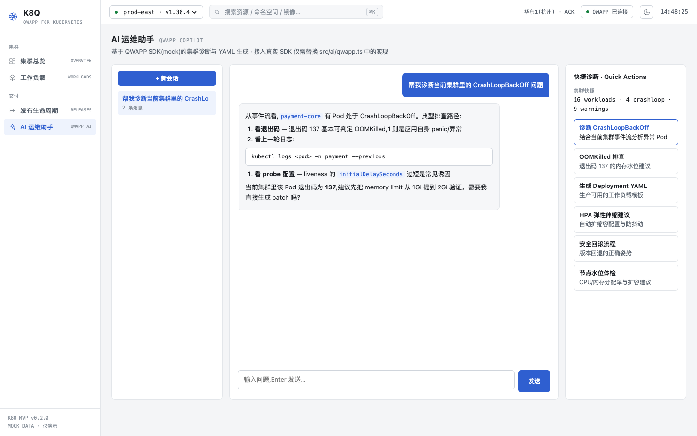
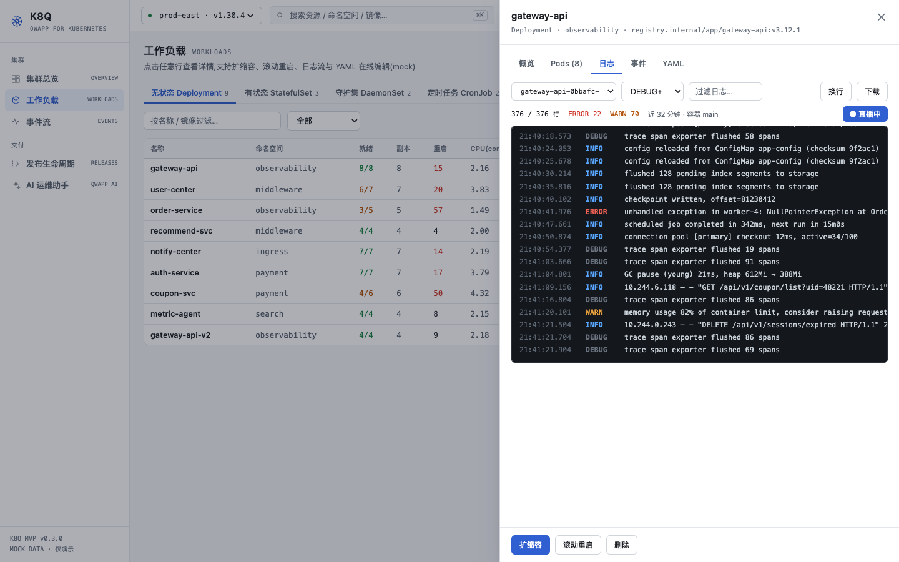
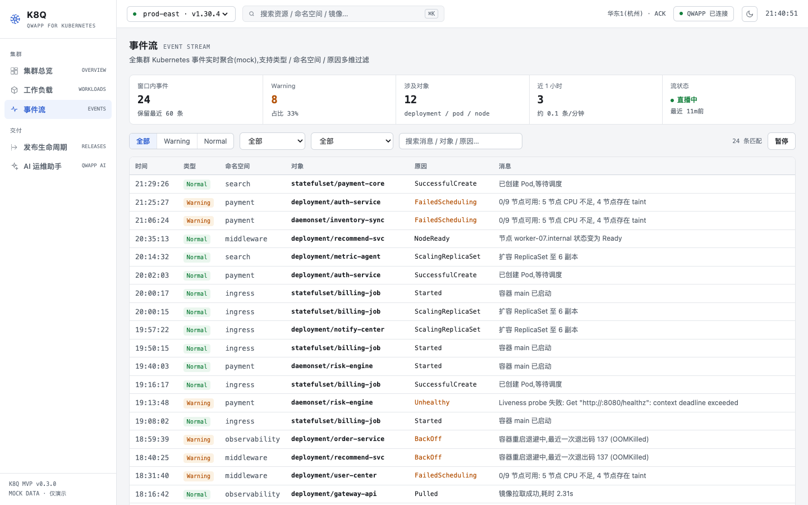
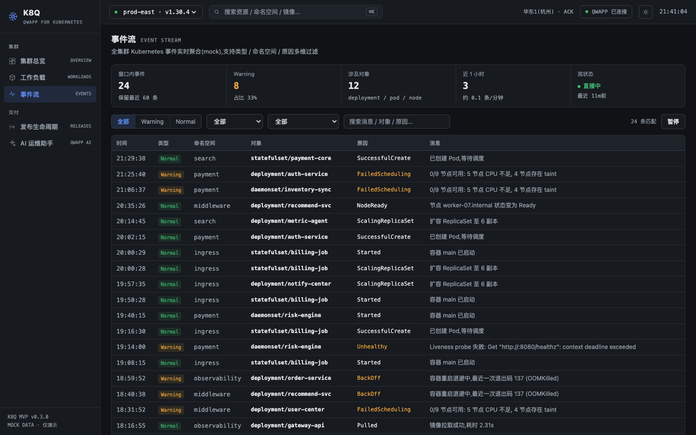

# K8Q

QWAPP for Kubernetes —— K8S 全生命周期工作台(MVP,全量 mock 数据),可打包为千问办公(QwenWork)`.qwapp` 应用。

企业级双主题设计:默认白底,暗夜可选(顶栏切换,持久化);信息密度优先。设计规范见 [DESIGN.md](DESIGN.md)。


## 功能模块

| 模块 | 路由 | 说明 |
| --- | --- | --- |
| 集群总览 | `/#/dashboard` | 7 格 metric-strip、节点表(内嵌利用率条)、实时事件流、容量趋势 sparkline、Pod 状态分布、命名空间负载 |
| 工作负载 | `/#/workloads` | 四类资源 tab + 名称/镜像/命名空间过滤,详情抽屉(概览/Pods/日志流/事件/YAML),扩缩容、滚动重启、删除 |
| 事件流 | `/#/events` | 全集群事件实时聚合:类型/命名空间/原因/关键字四维过滤、暂停直播、窗口统计 |
| AI 运维助手 | `/#/assistant` | QWAPP SDK(mock)流式对话:CrashLoopBackOff / OOM / ImagePull 诊断、YAML 生成、快捷诊断 |
| 发布生命周期 | `/#/releases` | 应用卡片、3 步创建向导、滚动发布进度、版本历史、一键回滚 |
| 全局搜索 | 顶栏 / `⌘K` | 实时命中工作负载(名称/镜像/命名空间),回车直达过滤态 |
| Pod 日志流 | 工作负载抽屉 · 日志 | 终端风格日志查看器:级别/关键字过滤、直播/暂停、自动换行、下载 `.log`,CrashLoop pod 输出崩溃循环栈 |
| YAML 在线编辑 | 工作负载抽屉 · YAML | 查看高亮 / 编辑(Tab 缩进)/ 行级 Diff 预览 / 校验 / 应用变更——应用后真实写回 store 并触发调和动画与事件 |

## 界面预览

| 集群总览(白) | 集群总览(暗夜) | ⌘K 搜索 |
| --- | --- | --- |
|  |  |  |

| 工作负载 | YAML Diff(暗夜) | AI 助手 / 发布 |
| --- | --- | --- |
|  |  |  |

| Pod 日志流 | 事件流(白) | 事件流(暗夜) |
| --- | --- | --- |
|  |  |  |

## 启动

```bash
npm install
npm run dev      # http://localhost:5173
npm run build    # 产物输出到 dist/
```

## 打包并安装到千问办公(QwenWork)

```bash
./qwapp/build.sh
# 产物:qwapp/dist/io.kudig.k8q-0.3.0.qwapp(+ .sha256.json 摘要)
```

安装方式:
1. 把 `.qwapp` 文件**拖入 QwenWork 桌面端窗口**;
2. 或在 QwenWork 对话中说:`帮我安装这个 qwapp:<文件绝对路径>`。

> 若返回 `QWAPP runtime is not ready (disabled)`,需先在 QwenWork 设置中开启「开发者模式 / QWAPP 运行时」。

包内容(`qwapp/`):`manifest.json`(qwapp-v3 清单)、`instructions.md`(K8Q 运维助手系统指令)、`skills/`(crashloop-diagnosis、release-runbook)、`views/workbench.html`(工作台单文件视图,由 vite singlefile 构建生成)。

## 目录结构

```
src/
├── ai/qwapp.ts          # QWAPP SDK 适配层(接入点,见下)
├── mock/
│   ├── seed.ts          # 固定 seed 伪随机,刷新数据稳定
│   ├── data.ts          # 集群/节点/工作负载/事件/版本生成器
│   ├── logs.ts          # Pod 日志生成器(确定性 backlog + 实时流)
│   └── store.ts         # in-memory store + 操作 action + 事件/指标 ticker
├── components/          # Layout(主题切换/⌘K 搜索)、charts、Drawer/Modal/YamlView、LogViewer、YamlEditor
├── pages/               # Dashboard / Workloads / Events / Assistant / Releases
└── styles.css           # 双主题设计系统(:root 亮 + [data-theme=dark] 暗)
qwapp/                   # 千问办公应用包(manifest / instructions / skills / views / build.sh)
```

## 接入真实 QWAPP SDK

所有 AI 能力收敛在 `src/ai/qwapp.ts` 的 `QWAPPClient` 接口:

```ts
export interface QWAPPClient {
  chat(req: QWAPPChatRequest): Promise<void>  // onToken 流式回调
}
```

MVP 使用 `MockQWAPPClient`(关键词路由 + 预写诊断回复,逐 token 流式输出)。
接入线上时,将文件底部的导出替换为真实 SDK 实现即可,页面代码零改动:

```ts
// export const qwapp: QWAPPClient = new MockQWAPPClient()
export const qwapp: QWAPPClient = new LiveQWAPPClient()  // 包装真实 QWAPP SDK
```

同理,`src/mock/store.ts` 中的 action(scale / restart / rollback / createApp)
是将来对接真实 K8S API(client-go / apiserver 代理)的替换边界。

> 当前为演示版本,所有数据均为 mock,刷新后重置。
